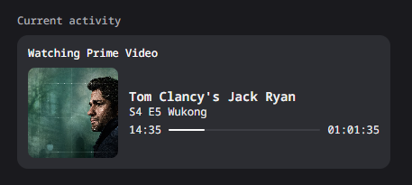
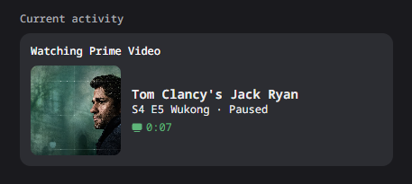

# Prime Video RPC

Show what you’re watching on Prime Video in your Discord profile, with the title, episode, artwork, playback timer, and paused status.

| Playing | Paused |
| --- | --- |
|  |  |

Works with **Google Chrome and Discord desktop on Windows 10/11**, using **primevideo.com in English**.

## Install

1. Download this repository using **Code > Download ZIP**, then extract it somewhere you’ll keep it.
2. Open `chrome://extensions` in Chrome and turn on **Developer mode**.
3. Click **Load unpacked** and select the extracted `extension` folder.
4. Double-click **Install.cmd** to install the small Windows helper. No administrator access is needed.
5. Keep Discord open, refresh Prime Video, and start watching. Open the extension popup to check that it says **Connected to Discord**.

The helper starts through Chrome. You don’t need to launch it yourself or create a Discord application.

## Choose what to share

Open the extension popup to turn sharing on or off and choose which details appear. Turn off **Show while paused** to hide the presence whenever you pause.

Each toggle controls its own field: hiding the title still leaves artwork or episode details visible if those switches are on.

## Need help?

- If your activity is missing, enable activity sharing in Discord’s settings and check **Share on Discord** in the extension.
- For missing episode details, move your pointer over the video to reveal the player controls.
- For connection errors, keep Discord open, run **Install.cmd** again if needed, then click **↻** in the popup.

Artwork and episode details depend on the player. If Discord rejects the artwork, the helper retries with text only.

## Update or remove

Before updating, switch off **Share on Discord**. Replace the project files, run **Install.cmd**, reload the extension at `chrome://extensions`, and refresh Prime Video. Then switch sharing back on.

To remove it, switch sharing off, remove the extension from Chrome, and run **Uninstall.cmd**.

## Privacy

Only your selected playback details are sent to Discord. Preferences stay on your computer. There’s no tracking, and no account tokens are required.

[Developer guide](docs/DEVELOPMENT.md) · [MIT license](LICENSE)

Unofficial project. Not affiliated with Amazon or Discord.
